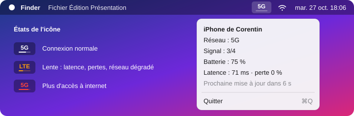

<div align="center">

# iphone-reseau

**Le type de réseau de ton iPhone (5G, LTE…) en permanence dans la barre des menus du Mac, quand tu es en partage de connexion.**




</div>

---

## Pourquoi

En partage de connexion, macOS sait déjà si l'iPhone capte la 5G ou la 4G : il l'affiche dans le menu Wi‑Fi. Mais il faut l'ouvrir à chaque fois. **iphone-reseau** garde cette information sous les yeux, et prévient quand la connexion se dégrade.

## Fonctionnalités

- **Type de réseau en direct** : 5G, LTE, 3G… lu à la même source que le menu Wi‑Fi de macOS.
- **Barre de progression** sous le libellé, jusqu'à la prochaine mise à jour (toutes les 10 s).
- **Alertes visuelles** :

  | Couleur | Signification |
  |---|---|
  | Normale (suit le thème clair/sombre) | Tout va bien |
  | 🟠 Orange | Latence > 250 ms, perte de paquets ou réseau descendu sous la 4G |
  | 🔴 Rouge | Plus d'accès à internet |

- **Menu détaillé** : nom de l'iPhone, signal, batterie, latence et perte de paquets, compte à rebours.
- **Quasi aucune ressource** : la barre est animée par Core Animation, le processus ne se réveille que pour relire les données (0,0 % de CPU mesuré).

## Installation

Dans le Terminal :

```bash
curl -fsSL https://raw.githubusercontent.com/Cocosg09/iphone-reseau/main/installer-iphone-reseau.sh | bash
```

L'installateur :

1. vérifie la présence des outils de ligne de commande Xcode (et propose de les installer) ;
2. compile l'outil **sur ta machine** : aucun binaire n'est téléchargé ;
3. l'installe dans `~/.local/bin/iphone-reseau` ;
4. propose de le lancer automatiquement à chaque ouverture de session.

Options : `--oui` pour tout accepter sans question, `--desinstaller` pour tout retirer.

```bash
curl -fsSL https://raw.githubusercontent.com/Cocosg09/iphone-reseau/main/installer-iphone-reseau.sh | bash -s -- --desinstaller
```

### Prérequis

- macOS sur un Mac avec Bluetooth et Wi‑Fi
- iPhone connecté au **même compte iCloud**, partage de connexion activé

## Utilisation en ligne de commande

```bash
iphone-reseau              # iPhone de Corentin : 5G · signal 3/4 · batterie 75 %
iphone-reseau --json       # même chose en JSON, pour un script
iphone-reseau --menubar    # icône dans la barre des menus (ce que lance l'installateur)
```

Pour que `iphone-reseau` soit trouvé directement, ajoute `~/.local/bin` à ton `PATH`.

## Comment ça marche

macOS n'offre pas d'API publique pour cette information. Le menu Wi‑Fi l'obtient du démon `sharingd` via la classe `SFRemoteHotspotSession` du framework privé **Sharing**, qui renvoie pour chaque iPhone à proximité son type de réseau, la force du signal et sa batterie. iphone-reseau interroge cette même classe, sans droit particulier.

La qualité de la connexion est mesurée en parallèle par 4 pings vers `1.1.1.1` à chaque rafraîchissement.

> [!WARNING]
> S'appuyant sur un framework privé, l'outil peut cesser de fonctionner après une mise à jour de macOS. Il affiche alors un message d'erreur clair plutôt qu'une valeur fausse.

## Développement

| Fichier | Rôle |
|---|---|
| [`iphone-reseau.m`](iphone-reseau.m) | Tout le code source (Objective-C, AppKit, Core Animation) |
| [`build.sh`](build.sh) | Compile et installe dans `~/.local/bin` |
| [`generer-installateur.sh`](generer-installateur.sh) | Réinjecte la source dans l'installateur après une modification |
| [`installer-iphone-reseau.sh`](installer-iphone-reseau.sh) | Installateur autonome à partager |

Les seuils (latence, intervalle) se règlent en haut de `iphone-reseau.m`.

## Licence

[MIT](LICENSE) © Corentin Saint-Genes
